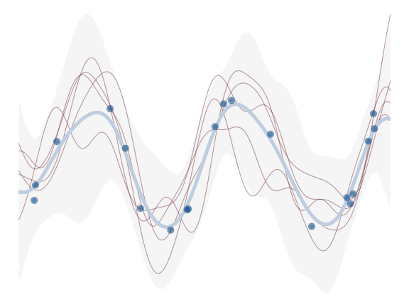
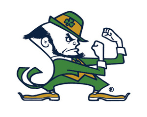
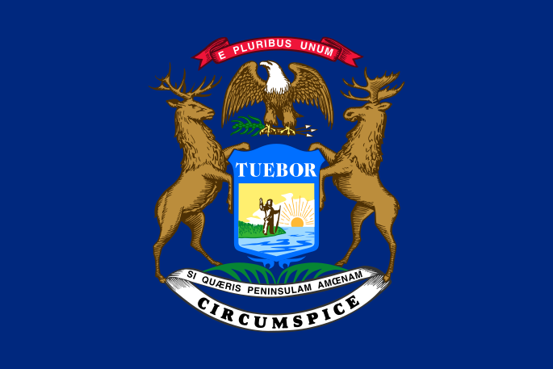
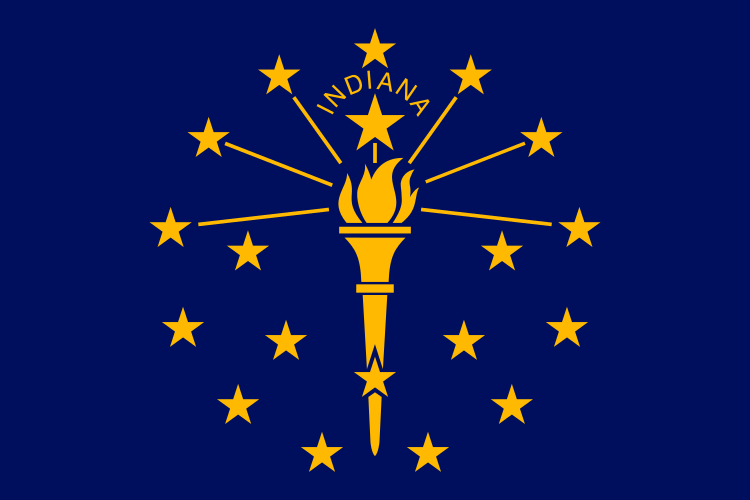
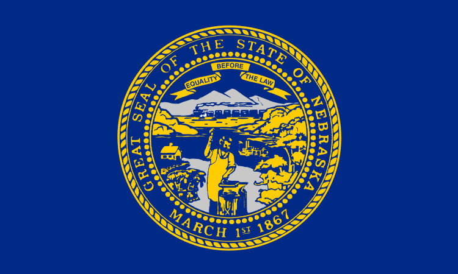

## What I do 

I am a Senior Machine Learning Scientist at [OneSix](https://www.onesixsolutions.com/), where I have led over a dozen client engagements across healthcare, pharma, insurance, logistics, and marketing, for Fortune 100 companies and boutique firms alike. Most of my work falls into a few areas:

- **Forecasting**: from quantile-loss models built to capture extreme events, to an internal accelerator that unifies classical, neural, and pretrained foundation-model approaches, with drift and calibration monitoring built in, ready to apply to any client’s data.
- **Causal inference**: estimating what actually moved the needle, whether that’s a treatment’s effect on patient outcomes or a marketing campaign’s effect on sales.
- **Production ML**: taking workflows from data ingestion through retraining and monitoring, often entirely inside a client’s governed environment, such as probabilistic record linkage that never moves sensitive data out of Snowflake.
- **AI systems**: agents that answer natural language questions over enterprise data, along with the observability needed to know when they get it wrong.

The field has changed a lot in the last couple of years. AI now writes most of the code, and agents can do genuinely useful work. In my experience, they work best with a tight human loop during exploration, and can be left to run on their own once the problem is well defined. The perhaps surprising part is that this has made the statistical side of the job more important, not less. Whether a model is right, how uncertain it is, whether an effect is causal or merely correlated, and whether an agent’s confident answer deserves that confidence are not questions a better LLM answers for you. Those are the questions I still find most interesting, and they’re where I spend much of my time.

Earlier in my career, I navigated a vast landscape of *modeling*, *visualizing*, and *understanding* data across dozens of industries and academic disciplines. I have classified biomedical images to detect pathology, analyzed text to uncover political sentiment, and explored baboon survival rates based on their social status.

I also have a strong background in teaching, writing, and conducting workshops, enabling others to gain expertise and become self-sufficient. I’m the author of [Models Demystified](https://m-clark.github.io/book-of-models/), which offers a comprehensive overview of the statistical and machine learning landscape, from linear regression to deep learning. It is available from [CRC Press](https://www.routledge.com/Models-Demystified-A-Practical-Guide-from-Linear-Regression-to-Deep-Learning/Clark-Berry/p/book/9781032582580) and on [Amazon](https://www.amazon.com/Models-Demystified-Chapman-Hall-Science/dp/1032582588). It is widely acknowledged as one of the greatest book covers in the history of data science 😆.

What drew me to data science, and keeps my interest, is that it frees me to engage in many different domains, and it provides a great many tools with which to discover more about the things we humans are most interested in.

## Academic Background    

While my interest is in data science generally, I started off majoring in [psychology](https://www.psy.tcu.edu/) and [philosophy](https://www.phil.tcu.edu/) as an undergraduate, and eventually obtained a Ph.D. in [Experimental Psychology](https://psychology.unt.edu/). During graduate school, I became interested in statistical science for practical reasons, eventually choosing it as a concentration, and I also started consulting at that time. That turned out to be a good fit for me, and I’ve been exploring and analyzing data ever since. After my formal education, I worked as a data science consultant at the Universities of North Texas, Notre Dame and Michigan, the last as Lead Statistician, where my work with faculty across the social sciences, business, and medicine contributed to 16 publications with over 1,000 citations.

## Personal     

I was born and raised in Texas, and aside from high school, was there throughout grad school and beyond. I have also lived a good chunk of my life in the Midwest, but I recently moved to the Research Triangle area of North Carolina with my wife, our daughter, and our dog Sulu. We tend to keep things simple, and like to go on walks and hikes in the neighborhood and surrounding areas, take the occasional trip to some place new, and make big deals out of the little things.

My older CV is [here](cv-non-acad.llms.md), though [LinkedIn](https://www.linkedin.com/in/michael-clark-b475b5170/) has the most current picture of my work. If interested in more details, feel free to [inquire via email](mailto:stats.data.sci@gmail.com).

  

  

MICHAEL CLARK

## Reuse

[CC BY-SA 4.0](https://creativecommons.org/licenses/by-sa/4.0/)
