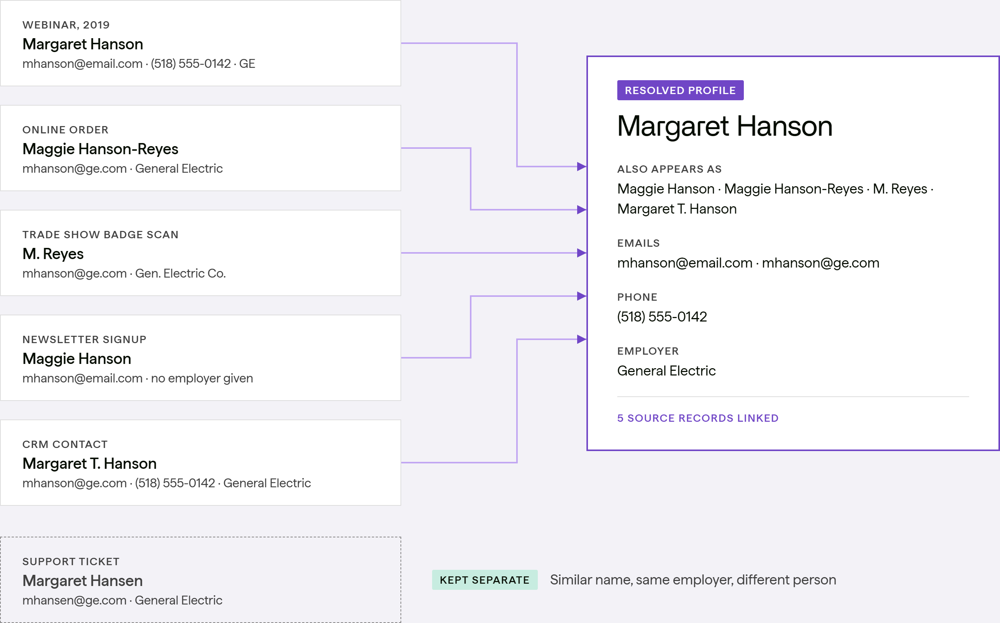
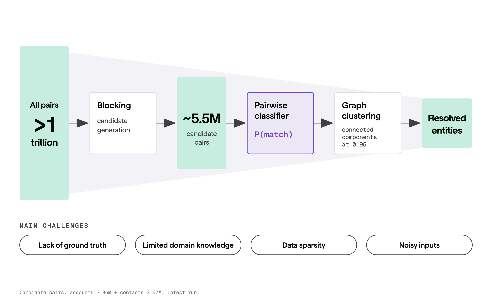

## Introduction

I recently wrote about identity resolution for the OneSix blog: [Same Person, Five Records: What Actually Works in Identity Resolution](https://www.onesix.ai/insights/identity-resolution). That post covers the basics, build vs. buy, cost, and where AI fits. Here I want to get into some of the other details.

So what is the core problem? Data is messy. You have a table of entities, and you want to know which records refer to the same person. Seems easy, except because of how the data is generated, the same entity may present multiple times, e.g. through different intake forms, different times of entry, different contexts. So you might have typos, different emails, different addresses and so forth, and in the end, two records (or more for that matter) for the same person may look quite different when comparing the rows in the table.



## Record linkage is an old statistical problem

One of the fun aspects of this particular project was that it got me back into some old statistical territory I hadn’t visited in a while. The main model used was a modern implementation of the Fellegi-Sunter model ([Fellegi and Sunter 1969](#ref-fellegi1969theory)), which is a probabilistic model for record linkage. It uses the estimated parameters to calculate match weights, and then uses thresholds to determine whether two records are a match or not. This is the basis for many modern pairwise “score” steps in record linkage, and is implemented in packages like [splink](https://moj-analytical-services.github.io/splink/), which is what we used.

At its heart is a [basic mixture model](https://m-clark.github.io/models-by-example/em.html), which is a statistical model that assumes that the data is generated from a mixture of different distributions. These can be the same type of distribution, like a mixture of Gaussians, or different types of distributions, like a mixture of Bernoulli and Poissons as in [zero-inflated models](https://m-clark.github.io/models-by-example/zi.html). In our case, we have two distributions: one for matches and one for non-matches. The model estimates the parameters of these distributions, and then uses them to calculate the probability that two records are a match or not. In this case, the data is generated from a mixture of matches and non-matches on the fields. Matches don’t have to be strict, and one can use any comparison such as a fuzzy string comparison, geographic distance. In our case we even used embedding similarity for some fields.

The model estimates [two key probabilities](https://www.robinlinacre.com/m_and_u_values/), \\m\\ and \\u\\. These are defined as:

\\m = P(\text{field matches} \| \text{records match})\\ \\u = P(\text{field matches} \| \text{records do not match})\\

The \\u\\ probabilities are estimated from the data. For example, if we have 1000 comparisons and 3 of them have the same birthdate, the u for that field is 0.003.

The \\m\\ probabilities are estimated via [expectation-maximization](https://m-clark.github.io/models-by-example/em.html). This is more difficult because we don’t know which records are matches and which are not. The EM algorithm iteratively estimates the parameters of the model until convergence, and the final estimates \\m\\ and \\u\\ are used to calculate the match weights as:

\\w = \log_2\left(\frac{m}{u}\right)\\

The inner ratio is basically a Bayes factor that tells us how much more likely it is that the field matches given that the records match, versus given that the records do not match. Consider date of birth. By chance the month might match roughly 1/12 = 0.083 of the time. If the records are a true match, the month may match with a probability of .99[^1]. So the Bayes factor is 0.99/0.083 = 11.9, meaning that if birth month matches, the records are ~12 times more likely to be a match than not.

Logging the Bayes factor makes them more tractable as Bayes factors can be extremely large or small, but also that we can then simply add the weights across fields to get a total weight for the record pair. This is the basis for the pairwise “score” step in record linkage, and is implemented in packages like [splink](https://moj-analytical-services.github.io/splink/), which is what we used. You start with a prior weight, which is basically related to the probability of a match in general. You the add the weights for each comparison/field, which can be positive or negative to get a total score. The total weight is usually expressed a single probability of match vs. not.

A great reference for this is Robin Linacre’s [blog post](https://www.robinlinacre.com/m_and_u_values/). He is the lead author of the Splink package, which itself has great documentation for learning more.

At this point, we have a good idea of the core matching process, but to get there we have to have comparisons to score and match in the first place. At first blush you may think this straightforward, but as we’ll see it is not.

## Blocking: from a trillion pairs to a few million

Here are some numbers for you. If I want to make every pairwise comparison for 100 records to determine which ones are the same person, I have to make ~5K comparisons. For 1,000 records, it’s ~500K comparisons. For 10,000 records, it’s ~50M comparisons. You see where this is going, and it’s simple arithmetic.

\\ \frac{n\_{records}(n\_{records}-1)}{2} \\

In my case, I had one table with ~1.6 million records and the other with a bit under half that. So how do we make this tractable?

The answer is **blocking**. Blocking is a way to reduce the number of comparisons by only comparing records that are likely to match. For example, we might only compare records that have the same last name and year of birth. This may reduce the number of comparisons from trillions to a few million, which is much more manageable.

In my project, even just using last name alone wasn’t viable, but generally adding some aspect of date of birth or other combinations of fields both reduced the number of comparisons, and increased the possibility that a true match would not slip through the cracks. And this is key point. We want to reduce the number of comparisons, but we don’t want to miss any true matches. So we have to be careful about how we block, and we have to be aware of the data quality issues that can arise.



### Data quality matters

When blocking, it’s not enough to just have a good rule in place. Say you have something like last name + DoB. You might look closer and see last names like `A`, `asdf`, `Name`, `lastname`, etc. Or you notice that many DoBs are 1900-01-01. Again, if one of those shows up 200 times, you just created almost 20K useless comparisons. Furthermore, when you go on to make the actual comparisons, you would likely flag some of these records as a match if you have little other information to go on.

So data quality matters, and it matters a lot. In my case, we it was an iterative process of examining blocking/matching results, finding new data issue to resolve, and then re-running the process. This is a common theme in data science, and it is especially true in record linkage.

### Blocking for prediction vs. blocking for estimation

What we’ve been talking about so far is blocking for prediction. That is, we want to create comparisons to give a probability score to, and we want to do our best to not have any true matches slip through the blocking rules.

But estimation is different, and here we want to create blocks that actually are a mix of matches and non-matches. This is because the EM step is fitting a two-group mixture and can only separate the groups if both are present. Furthermore, when we’re blocking for estimation, the blocks already agree for every pair considered by construction, so what it does is allow us to estimate the \\m\\ values **for the other fields**. So in practice, you run several passes with different blocking rules, each one estimating the fields the others had to skip.

Unfortunately there is not a lot of guidance for blocking for prediction or estimation that would hold across data context. And certainly no guarantee that, for example, you don’t miss a true match or create passes that estimate stable \\m\\ values. This is something you have to investigate and iterate on.

## From pairs to entities

Once you have your pairwise matches scored, you can then cluster based on a threshold (say any records with \>= .90 probability of a match), and ultimately resolve them into single entities via *survivorship* rules. This is where domain knowledge is immensely helpful. For example, if you have two records that match on name and DoB and employer, but one has an address in New York and the other in California, you need some sort of rule for deciding which field to keep. In this case, you might decide to keep the address that is most recent, or the one that is most complete. There is no hard and fast rule here.

In addition, you won’t always simply have two records that match. You might have a cluster of multiple records that reach threshold. In addition, the property of *transitivity* means that if A matches B for a given threshold, and B matches C, then A and C end up in the same cluster, even if they don’t reach the threshold. This is where domain knowledge is again helpful, as closer inspection of larger clusters may be warranted before assessing survivorship and to avoid over-merging.

## Evaluation without ground truth

A key aspect of identity resolution is that we generally don’t have ground truth. That is, we don’t know for sure which records are a match and which are not. This makes evaluation difficult, and it is should be kept in mind when designing the process.

In our case we created an evaluation set that was manually reviewed by someone from the client team. This was a small set of records, enough for them to be able to do over the course of a few days along with their other work. But it also was enough to give us a sense of how well the model was agreeing with them and possibly spot gaps in the matching process. But it is very possible that human and model are wrong, or that there is no clear answer as to which is right given the information available. In some cases the human reviewer simply put ‘not enough information’ - honest and valid! But the model will always come to a decision, which is another useful aspect of it.

Our pipeline recall, assuming the human label was truth, ranged from .8-.9 depending on the data source. This was encouraging, especially given the little time we had to build and tweak the process. But we saw as just a starting point. Part of the pipeline we built makes it easy to add to it over time, so that the performance can be assessed with more accuracy. We also supplemented this process with AI review as well, which we discuss in the next section.

## Using AI for identity resolution

Intro sentence needed.

### Just throw AI at it!

Some may think that AI is a magic bullet for identity resolution, and in some cases it might be. Here we could have used Snowflake’s `AI_COMPLETE` to assess whether multiple fields across the millions of paired records were a match or not. A default approach works rowwise, and so would have basically been done for each pair of records. With a frontier model and the estimated token count, the cost could have been over \$3K for one run. Depending on how often you need to run it and budgetary constraints, this could be a non-starter.

This task is fairly simple though, so you could use something like Claude Haiku or GPT-Luna which would have made it much more tractable (\<\$200 by our estimates). Probably not as accurate but one would need to test this. We actually used Haiku for the small evaluation set[^2]. And of course the models continue to improve.

A few things you don’t get with the AI approach: - You still have to do the blocking to create the pairs to evaluate. - You still have to the clustering and survivorship rules to resolve the pairs into entities. - You have no additional information about what went into the decision without additional cost.

### LLM classifiers as a game changer

My project finished up the same month Jev came out. Jev is a LLM-based classifier that is designed to make very fast *structured* decisions on data. It can make classifications given provided labels, probabilities, and a confidence score. Other outputs include a simple probability for a yes/no situation (also very applicable here) or an ordered response. For example, we could set Jev up to create a probability to the so-called [*Noul*](https://docs.typesafe.ai/primitives/noul) type question of ‘Are these two records a match?’. We could even do something like a [*Choice* type question](https://docs.typesafe.ai/primitives/choice) of ‘Which category of match are these two records?’ with options like ‘Match’,‘Not a match’, and ‘Not enough information’. This would provide a probability of each option, and a confidence score for the overall classification of zero to 1.

The best part is that this is fast and very cheap to using a standard frontier model, even for their smaller versions. We think it would have been a perfect supplement to the pipeline model (which is still way cheaper), and having two results could have potentially improved the identity resolution process by making agreement an automatic check for resolution.

## Doing it yourself

## Summary

Fellegi, Ivan P., and Alan B. Sunter. 1969. “A Theory for Record Linkage.” *Journal of the American Statistical Association* 64 (328): 1183–210.

## Footnotes

## Reuse

[CC BY-SA 4.0](https://creativecommons.org/licenses/by-sa/4.0/)

## Citation

BibTeX citation:

``` quarto-appendix-bibtex
@online{clark2026,
  author = {Clark, Michael},
  title = {Same {Person,} {Five} {Records}},
  date = {2026-10-23},
  url = {https://m-clark.github.io/posts/2026-10-23-identity-resolution/},
  langid = {en}
}
```

For attribution, please cite this work as:

Clark, Michael. 2026. “Same Person, Five Records.” October 23. <https://m-clark.github.io/posts/2026-10-23-identity-resolution/>.

[^1]: Because of data entry errors, missing values, and other issues, we don’t expect a perfect match even for true matches.

[^2]: Sample size was 500 so cost was not an issue at all in this case. Our results were a little less aligned with the LLM reviewer, but still pretty good. The LLM-Human agreement was ~85% and the LLM was able to make a decision on all pairs, whereas the human reviewer had ~1/3 of the pairs as ‘not enough information’. This is a good example of how AI can be used to supplement human review, especially when there is no clear answer.
